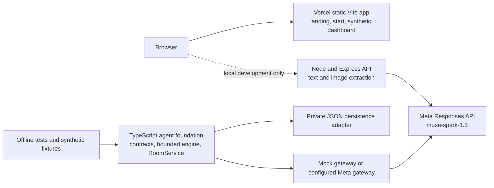

# Setvia

**Live app:** [setvia.r4yv.tech](https://setvia.r4yv.tech)  
**Planning dashboard:** [setvia.r4yv.tech/dashboard](https://setvia.r4yv.tech/dashboard)  
**Source:** [github.com/rayvin04/setvia](https://github.com/rayvin04/setvia)


Make plans that survive the group chat.

Setvia helps a group turn an invitation and scattered replies into a plan people can review together. Its public site is a Vite frontend hosted on Vercel. The dashboard is a synthetic preview; the deployed site does not currently provide live room collaboration.

## Why Meta AI

Setvia uses Meta Muse Spark for text and image plan extraction and as the model target for its agent foundation. The server pins the official Meta Responses endpoint and `muse-spark-1.3`. Model output is treated as a suggestion: schemas validate handoffs, the server checks constraints and readiness deterministically, and people make the final decision.

## Architecture



The agent foundation and JSON persistence are checked-in domain code with offline tests. They are not connected to a production room HTTP transport or the Vercel site. The local Express API currently exposes `/api/health` and the text/image extraction endpoints only.

## Agent roles and bounded loop

- **Listener** turns an incoming response into unconfirmed facts. Private input stays in the owner's private lane until the owner explicitly shares a candidate.
- **Judge** checks evidence, findings, options, unresolved issues, and whether another role is needed.
- **Negotiator** proposes alternatives that the server checks against room facts and participant constraints.
- **Question Strategist** prepares bounded, optionally targeted questions for missing information.
- **Speaker** selects which validated questions and findings to present and chooses a bounded mascot state. The server renders authorized text, and a final Judge pass must accept the presentation before publication.

The engine follows typed Judge decisions and can skip roles that are not needed. Revisions, model invocations, HTTP attempts, time, token reservations, and estimated cost are capped outside model output. Repeated proposals, stale work, cancellation, and failures stop safely. A cycle can complete, wait for participant input, continue, or block; waiting does not trigger polling. A model result or a 100% readiness score never counts as a human approval.

## Six Reality Checks

- **Schedule Check:** availability, timing conflicts, durations, and deadlines.
- **Budget Check:** confirmed spending limits, estimated totals, and unclear costs.
- **People Check:** responses, accessibility, attendance conflicts, and assigned roles.
- **Logistics Check:** transport, locations, routes, venues, and coordination.
- **Preparation Check:** required equipment, supplies, materials, and preparation tasks.
- **Safety Check:** hazards, precautions, emergency preparation, weather, and route risks.

Each room has a six-category policy that defines applicability, weights, and required keys. The deterministic readiness scorer uses confirmed group-visible facts and the current policy. Unknown information scores as incomplete; participant-owned constraints are evaluated against the proposed plan. Hard-constraint violations and critical unresolved issues block readiness. The strongest label is `ready_for_human_review`; it is not a safety guarantee, external fact check, or group vote.

## Privacy, responses, and room membership

Private and group-visible responses have separate paths. The server projects only authorized room fields for a participant; private facts, Listener candidates, credentials, pending inputs, model traces, and prompts are not fields in the group projection. A private response can be analyzed for its owner without changing shared readiness. The owner must explicitly share a candidate before it enters group context. Sending text to a configured Meta gateway means Meta processes that text.

An event's estimated or confirmed attendee count is separate from the number of people actively in a planning room. Readiness, response tracking, and proposal approvals use actual room members, not the estimated event audience. The room contract caps active participants at 100. Approvals apply to one exact proposal version and are invalidated by material changes.

## What is real and what is synthetic

- The public landing page, `/start` flow, and `/dashboard` UI are real frontend code. Dashboard participants, room activity, readiness examples, and replies are authored synthetic previews.
- The local Node API implements text and image extraction through Meta Muse Spark when configured with a server-side `MODEL_API_KEY`. That API is not deployed with the public static site.
- The agent contracts, orchestration, deterministic readiness, room service, private projection, persistence adapter, and mock tests are real code. No authenticated room API or live multi-device collaboration is deployed.
- Scenario fixtures use fictional inputs. Their passing tests establish deterministic code behavior, not real-world accuracy or model reasoning quality.

### Recorded Muse Spark evaluation

The recorded evaluation covers **11 synthetic runs across five scenario templates**. The client initiated 39 outbound HTTP attempts targeting Meta, and the journal reserved budget for all 39 before each attempt. Thirty-eight received HTTP 200 responses and usage records; one cancelled/transport-error attempt has no HTTP status or usage record.

| Measure | Recorded result | Accounting |
| --- | ---: | --- |
| Client HTTP attempts | 39 | Started by the client; includes one cancelled/transport-error attempt |
| Ledger attempt reservations | 39 | Budget was reserved before each client attempt |
| Successful HTTP responses | 38 | All 38 returned HTTP 200 |
| Cancelled/transport-error reservation | 1 | No HTTP status or usage record; its US$0.104 reservation is included only in at-risk total |
| Automated assertions | 48 passed | Machine checks only; no completed human ratings |
| Estimated token usage | **US$0.296678** | From reported usage for the 38 responses, priced at Meta's published Standard rates |
| At-risk ledger amount | **US$0.400678** | Estimated usage plus the **US$0.104** reservation for the attempt without usage data |

The estimate uses Meta's published Standard rates of **US$1.25 per million input tokens** and **US$4.25 per million output tokens**. It ignores cached-input discounts and is not a provider invoice. The extra US$0.104 is a budget reservation for unknown usage, not money spent and not a promotional-credit deduction. Automated assertions check expected protocol behavior on synthetic inputs; they do not show that the agents are fully reliable or establish real-world planning quality. See [Meta Model API pricing](https://dev.meta.ai/docs/pricing-rate-limits) and the detailed [evaluation accounting](docs/agent-foundation.md#recorded-muse-spark-evaluation).

## Local development

Requires Node.js 24 LTS.

```powershell
npm ci
Copy-Item .env.example .env
# Add MODEL_API_KEY to .env using a private editor or secret manager.
npm run dev:server
```

In a second terminal, start the frontend:

```powershell
npm run dev
```

The local server listens on `127.0.0.1:3001`; Vite serves the UI on `127.0.0.1:5173`. Keep `.env`, credentials, and private prompts out of source control and shared logs. Agent prompts are not bundled in the repository; a server-side adapter must load them from private configuration and pass them to `createMetaGateway`. The current deployed frontend does not call the local extraction API.

## Routes and API

- `/`: landing page
- `/start`: text/image plan extraction UI and adaptive form
- `/join`: room-link preview
- `/demos`: fictional scenario entry point
- `/dashboard`: synthetic planning dashboard
- `GET /api/health`: local API readiness
- `POST /api/ai/extract/text`: local extraction from up to 8,000 characters
- `POST /api/ai/extract/image`: local extraction from PNG, JPEG, or WebP images up to 5 MiB

## Verification and CI

```sh
npm test
npm run check:server
npm run build
```

GitHub Actions runs `npm ci`, these test and build commands, and the server type check on pushes and pull requests. Tests use mocked Meta responses and synthetic inputs. The separate `npm run test:meta` command can make billable requests and is not run by CI.

## Docker status

There is no Dockerfile or Compose setup yet. The current checked-in Express server serves extraction only; the room engine and JSON persistence are not wired into a production room transport. The persistence adapter is single-process JSON storage and still needs deployment-specific durability, access-control, retention, backup, and recovery validation. Packaging it now would imply a ready persistent collaboration backend that has not been verified. Docker was unavailable in the authoring environment, so no container build was verified.

## Known limitations and assets

Real-world prices, routes, weather, accessibility, venue details, and hazards are not externally verified. AI output requires human review, and readiness does not establish safety or unanimous approval. Production room authentication and delivery, durable multi-instance storage, room administration, external Reality Check sources, and Visual Planner inference remain future work.

Lexend is provided by `@fontsource-variable/lexend` (OFL-1.1); icons use `lucide-react` (ISC). The GitHub mark includes its license file. See [`docs/ASSETS.md`](docs/ASSETS.md) for asset notes and [`docs/meta-api.md`](docs/meta-api.md) for the extraction API boundary.

The agent contracts, test scope, private prompt boundary, evaluation accounting, and persistence limitations are documented in [`docs/agent-foundation.md`](docs/agent-foundation.md).

