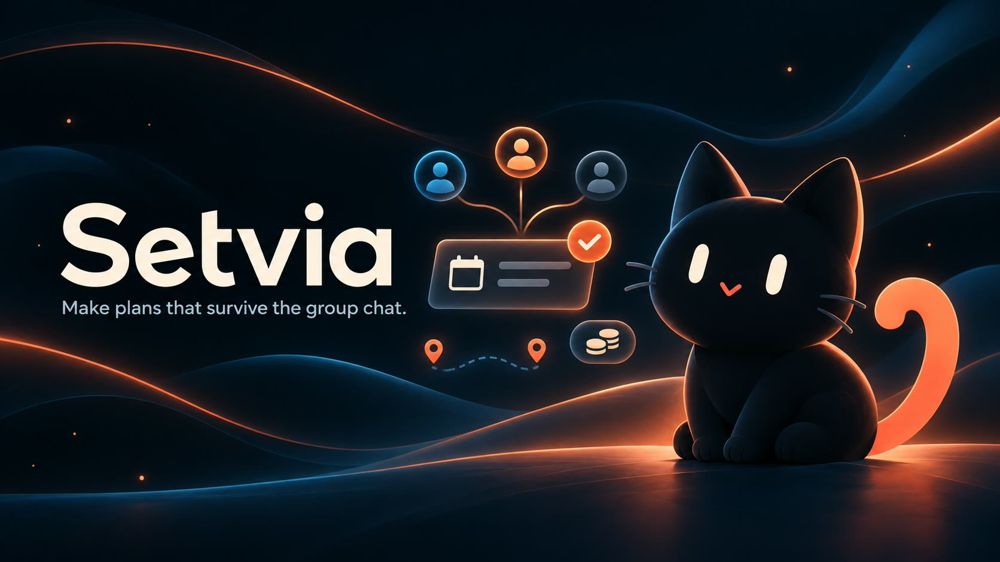
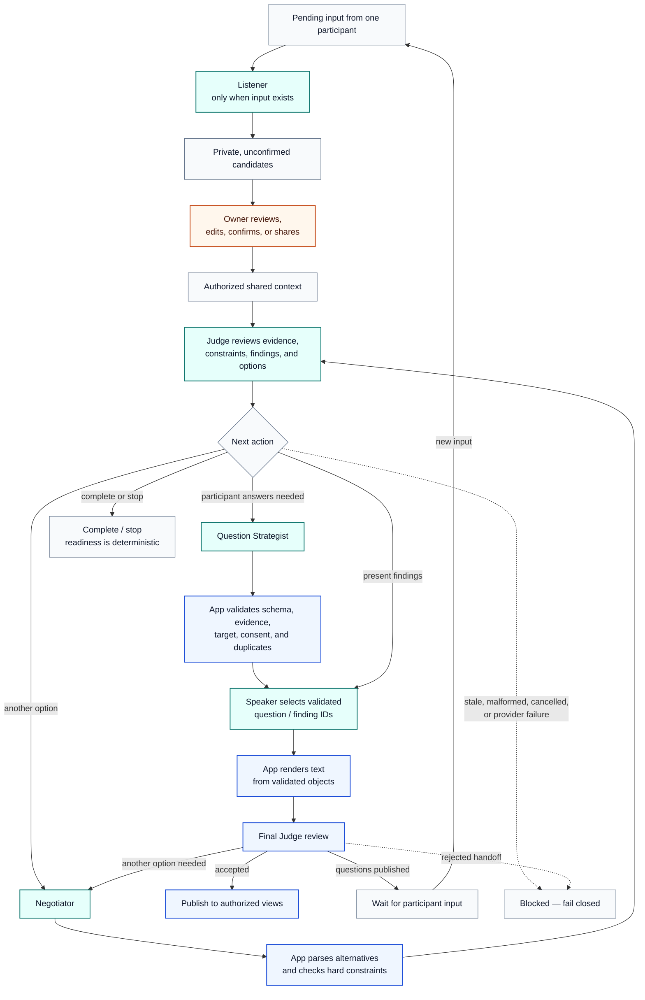

  

<h1 align="center">Setvia</h1>

  
  
  
  
  
  

Setvia helps a group turn scattered ideas, constraints, and concerns into a plan participants can review together.

**Make plans that survive the group chat.**

## Hackathon submission

|                               |                                                                                                                                                                                                                                       |
| ----------------------------- | ------------------------------------------------------------------------------------------------------------------------------------------------------------------------------------------------------------------------------------- |
| **Event**                     | [Meta Global AI Developer Hackathon 2026](https://dev.meta.ai/events/global-hackathon)                                                                                                                                                |
| **Track**                     | Indie Developer — documented project intent; confirm against the entrant account before submission                                                                                                                                    |
| **Theme / problem statement** | Build for Your World — intended selection from the project brief; entrant-side selection still needs confirmation                                                                                                                     |
| **Development period**        | Built from scratch during the hackathon window: October 26 – November 4, 2026                                                                                                                                                          |
| **Website**                   | [setvia.r4yv.tech](https://setvia.r4yv.tech) — static Vite frontend, with a four-role Muse Spark playground; `/demos` and `/dashboard` use fictional preview data                                                  |
| **Repository**                | [rayvin04/setvia](https://github.com/rayvin04/setvia)                                                                                                                                                                                 |
| **Demo video**                | **Pending.** Add the real recording URL here when it exists.                                                                                                                                                                          |
| **Submission status**         | Preparing the final submission. This repository does not claim portal submission or an award.                                                                                                                                        |
| **Technical documentation**   | [Architecture](docs/architecture.md) · [Meta API reference](docs/meta-api.md) · [Judge guide](docs/judge-guide.md) · [Agent foundation and evaluation](docs/agent-foundation.md) · [Living playground](docs/living-playground.md) · [Third-party notices](docs/third-party-notices.md) |

Setvia did not exist before the hackathon. It was built from scratch during the October 26–November 4, 2026 build window.

## Why Setvia exists

In the Philippines, people sometimes call a plan that never happens **“drawing lang”**: literally “just drawing,” and in this context, an idea that stays talk or on paper. A group chat can be full of enthusiasm for a trip, reunion, meeting, birthday, or project, while the date, budget, transport, responsibilities, and open concerns are still unresolved.

Setvia is designed for the shared problem behind those situations: **several people need to agree on one plan while they have different priorities and constraints.** It can support friends arranging an outing, families organizing a reunion, students coordinating a project, professionals planning a meeting, businesses and wedding committees organizing events, and community or volunteer teams coordinating activities.

The software makes proposed facts, constraints, missing details, questions, and decisions easier to review together. This is the product goal; no user study or outcome measurement is being used to claim that Setvia has reduced cancellations or improved planning results.

## Judge map

This table is a navigation aid, not an official weighted rubric. The project notes do not include an entrant-verified percentage breakdown, so none is published here.

| Area                            | Evidence in this repository                                                                                                                                                                                                                                                                                                                                                                                                                                                                                         |
| ------------------------------- | ------------------------------------------------------------------------------------------------------------------------------------------------------------------------------------------------------------------------------------------------------------------------------------------------------------------------------------------------------------------------------------------------------------------------------------------------------------------------------------------------------------------- |
| **Impact**                      | [Why Setvia exists](#why-setvia-exists), the [six Reality Checks](#six-reality-checks), and the [planning lifecycle](docs/architecture.md#d-planning-lifecycle)                                                                                                                                                                                                                                                                                                                                                     |
| **Use of Meta AI**              | [Model-to-source map](#meta-model-to-source-map), [Meta API client](https://github.com/rayvin04/setvia/blob/main/server/src/ai/meta-client.ts), and [agent gateway](https://github.com/rayvin04/setvia/blob/main/server/src/agents/meta-gateway.ts)                                                                                                                                                                                         |
| **Technical depth**             | [Architecture diagrams](docs/architecture.md), [typed contracts](https://github.com/rayvin04/setvia/blob/main/server/src/agents/contracts.ts), [orchestration](https://github.com/rayvin04/setvia/blob/main/server/src/agents/engine.ts), [readiness](https://github.com/rayvin04/setvia/blob/main/server/src/agents/readiness.ts), and [privacy boundaries](docs/architecture.md#c-privacy-boundaries) |
| **Demo and product experience** | [Judge demo path](docs/judge-guide.md) and the [public synthetic preview](https://setvia.r4yv.tech/demos)                                                                                                                                                                                                                                                                                                                                                                                                           |

## What judges can try today

The homepage’s **Meet the minds** section has four role cards, each with three fictional examples. Clicking Run replaces that card’s teaser with the selected input and a compact Muse Spark 1.3 response; a live/cached label keeps replay status clear. No model request happens on page load. See the [playground guide](docs/living-playground.md).

The public [scenario page](https://setvia.r4yv.tech/demos) and [planning dashboard](https://setvia.r4yv.tech/dashboard) use fictional preview data; those routes do not call a live model or create a shared planning room. The Vite frontend uses a separate Express API for model-backed actions. The Meta API key stays on the server. See the [judge guide](docs/judge-guide.md) for the public and local paths.

## Meta model-to-source map

The server uses Meta's Responses API at `https://api.meta.ai/v1/responses`, with the pinned Standard model ID `muse-spark-1.3`. All five named roles use this same Meta model with different role contracts; they are not five separate models. The API key is read by the server from `MODEL_API_KEY`; it is not sent to the browser. Model output is treated as an untrusted suggestion and parsed against typed schemas.

| Model / role                                                                   | Purpose                                                                           | Source location                                                                                                                                                                                                                                                                                                                                                                                        | Status in current main                                                                                                                                                                                                                                                        |
| ------------------------------------------------------------------------------ | --------------------------------------------------------------------------------- | ------------------------------------------------------------------------------------------------------------------------------------------------------------------------------------------------------------------------------------------------------------------------------------------------------------------------------------------------------------------------------------------------------ | ------------------------------------------------------------------------------------------------------------------------------------------------------------------------------------------------------------------------------------------------------------------------------ |
| **Muse Spark 1.3 — plan extraction**                                           | Extract candidate planning details from text or an image using structured output. | [Meta client](https://github.com/rayvin04/setvia/blob/main/server/src/ai/meta-client.ts) · [text extraction](https://github.com/rayvin04/setvia/blob/main/server/src/ai/extract-plan.ts) · [image extraction](https://github.com/rayvin04/setvia/blob/main/server/src/ai/extract-image.ts) | The extraction API is separate from the static Vite frontend. The local UI/API path has been exercised with mocked responses; this README makes no live text/image extraction claim.                                                                                             |
| **Muse Spark 1.3 — Listener, Judge, Negotiator, Question Strategist, Speaker** | Conditional role calls with typed handoffs; one model serves distinct application roles. | [role contracts](https://github.com/rayvin04/setvia/blob/main/server/src/agents/contracts.ts) · [engine](https://github.com/rayvin04/setvia/blob/main/server/src/agents/engine.ts) · [Meta gateway](https://github.com/rayvin04/setvia/blob/main/server/src/agents/meta-gateway.ts) · [playground API](server/src/playground/router.ts) | The homepage demonstrates bounded role calls on explicit user action. Speaker uses Question Strategist → Speaker. The complete group-planning cycle is distinct from these examples; private prompts stay server-side. |
| **Muse Image 1.0 — Visual Planner**                                            | Possible future illustrations for a plan or preparation record.                   | The [VisualPlanner interface](https://github.com/rayvin04/setvia/blob/main/server/src/agents/contracts.ts) is an extension point only.                                                                                                                                                                                                                             | **Planned, not integrated.** No image-generation request is made by the released code.                                                                                                                                                                                         |
| **SAM 3.1, Muse Voice, Muse Spark Open**                                       | —                                                                                 | —                                                                                                                                                                                                                                                                                                                                                                                                      | Not integrated in the released base.                                                                                                                                                                                                                                           |

## How the agent system works

Setvia uses five conditional roles, not a fixed five-call chain. The Judge selects the next useful action, and application code validates every handoff before it can affect the room.

**Diagram key:** Teal nodes are model roles, blue nodes are application checks and rendering, orange is owner control, and gray nodes are room state. Solid arrows show conditional transitions; dashed arrows show fail-closed outcomes.

| Role                    | When it runs and what it sees                                                                       | Output and application boundary                                                                                                                                                          |
| ----------------------- | --------------------------------------------------------------------------------------------------- | ---------------------------------------------------------------------------------------------------------------------------------------------------------------------------------------- |
| **Listener**            | When a participant has pending input. It sees that person’s text and their own private facts.       | Creates private, owner-scoped candidates. The owner must explicitly confirm or share a candidate before it enters group context.                                                         |
| **Judge**               | When there is authorized context to review: evidence, constraints, findings, and candidate options. | Returns a typed next action. The application determines which role runs next.                                                                                                            |
| **Negotiator**          | Only when the Judge requests another option.                                                        | Returns typed alternatives. The application parses them and checks hard constraints before an option can be accepted.                                                                    |
| **Question Strategist** | When participant answers are needed.                                                                | Returns typed questions. The application checks schemas, finding references, targets, consent for public targeting, and repeated questions.                                              |
| **Speaker**             | When validated findings or questions need to be presented.                                          | Selects validated question/finding IDs and a bounded mascot state. The application renders text from those objects, then a final Judge pass reviews the presentation before publication. |

Role contracts use strict Zod schemas; the Meta gateway converts them to structured JSON Schema output. Findings reference known group facts or constraints. Application code, not model prose, enforces hard-constraint comparisons, deterministic readiness, privacy projections, request reservations, and versioned approvals.

The engine can continue, wait for participant input, complete, or block. Provider output/context limits, timeouts, and the no-progress/revision safeguards remain bounded, but the application does not impose a lifetime, per-cycle, token, or spending quota on normal Meta planning. Agent requests reserve an attempt for historical accounting before sending it and disable automatic retries. Cancellation, stale room revisions, malformed output, unsupported evidence, and interrupted work fail closed. A blocked or stale cycle cannot publish a new readiness result.

The four homepage cards are focused demonstrations, not a full group-planning session: they do not create a room or collect participant approvals. The room engine separately manages multi-step cycles, privacy projections, proposal versions, and human approval.

## Six Reality Checks

The policy supports six categories. It decides which categories apply, which facts are required, how much weight each category has, and whether evidence is needed for each participant.

The examples use one fictional Sunday beach trip; the outcomes are illustrative and do not use live venue, route, price, or weather data.

| Check                 | What it checks                                    | Useful evidence                                 | Example (fictional trip)                                         |
| --------------------- | ------------------------------------------------- | ----------------------------------------------- | ---------------------------------------------------------------- |
| **Schedule Check**    | Availability, conflicts, duration, and deadlines. | Participant calendars and the proposed time.    | Return at 5 PM conflicts with a 4 PM hard limit → blocked.       |
| **Budget Check**      | Individual caps, shared costs, and estimates.     | Confirmed caps and scoped cost estimates.       | Estimate is ₱1,250; hard cap is ₱1,000 → blocked.                |
| **People Check**      | Responses, access needs, attendance, and roles.   | Attendees, access details, and task owners.     | A required attendee has not responded → incomplete.              |
| **Logistics Check**   | Transport, venue, route, and coordination.        | Destination, transport plan, and sourced route. | Meeting point is set; route time lacks a source → incomplete.    |
| **Preparation Check** | Supplies, equipment, and responsibilities.        | Checklist and a named owner for each item.      | Water and sunscreen are listed; nobody owns pickup → incomplete. |
| **Safety Check**      | Hazards, precautions, and current local guidance. | Current reliable sources and human review.      | No current forecast or advisory has been reviewed → unresolved.  |

Missing or uncertain information is represented as absent or null facts, unconfirmed candidates, and findings with `missing`, `estimated`, or `conflicting` uncertainty. Required missing values leave a category unknown or incomplete. A hard constraint that the proposal fails to satisfy, a conflict in shared facts, or an unresolved critical finding can block readiness.

Readiness is a deterministic summary of the current policy and confirmed group-visible evidence. **It is not a safety guarantee, external fact check, or participant approval.** Real prices, routes, venues, accessibility, weather, and hazards are not independently verified by the released app.

## Readiness, revisions, and human approval

The room domain has two counters with different jobs:

- **Room revision** is the freshness guard. Each accepted room update advances it. Agent work is based on one revision; if the room changes before commit, that work is cancelled or rejected as stale.
- **Proposal version** identifies the exact plan that people review. Plan changes, shared facts, constraints, policy changes, and membership changes advance it in this base commit and clear approvals/questions that no longer apply.

Joining or leaving also advances the proposal version in the released base. Leaving removes that participant’s private facts, candidates, constraints, and pending inputs. Approvals are stored against the exact current version; stale-version approvals are rejected. The room rule requires each joined participant, not every estimated event attendee, to approve the same version. AI completion and a 100% readiness score cannot approve on anyone’s behalf.

## Evaluation and engineering evidence

The repository’s existing live-call accounting covers **11 synthetic runs across five scenario templates**. These figures are protocol and accounting evidence, not human evaluation or a model-quality benchmark.

| Measure                               | Recorded result | What it means                                                                                          |
| ------------------------------------- | --------------: | ------------------------------------------------------------------------------------------------------ |
| Client HTTP attempts                  |              39 | Includes one cancelled/transport-error attempt without an HTTP response.                               |
| Attempts reserved before requests     |              39 | The ledger reserved budget before each client attempt.                                                 |
| HTTP 200 responses with usage records |              38 | These responses supplied the usage metadata used for the estimate.                                     |
| Automated assertions                  |       48 passed | No completed human ratings are available.                                                              |
| Estimated usage from reported tokens  | **US$0.296678** | Calculated from the 38 usage records at the documented Meta Standard input/output rates.               |
| At-risk reserved amount               | **US$0.400678** | Includes the additional US$0.104 reservation for the attempt with unknown usage; this is not a charge. |

The estimate omits cached-input discounts and is not a Meta invoice. The automated assertions check expected protocol behavior on synthetic inputs; they do not establish planning accuracy, reliability, or real-world impact. See the [accounting details](docs/agent-foundation.md#recorded-muse-spark-evaluation).

The full group-planning cycle is separate from the four-card playground. The playground guide documents its bounded API, model roles, and verification; the synthetic accounting above does not claim a real-world planning-accuracy benchmark.

The repository includes offline tests, a server TypeScript check, and a frontend build. CI runs those checks without a Meta key; the separate `npm run test:meta` command can make billable Meta requests. No live Meta call was made as part of this documentation work.

## Where to find things

Source links below point to the current `main` branch.

| Concern                                 | Source                                                                                                                                                                                                                                                                                                                                                                                                                                                          |
| --------------------------------------- | --------------------------------------------------------------------------------------------------------------------------------------------------------------------------------------------------------------------------------------------------------------------------------------------------------------------------------------------------------------------------------------------------------------------------------------------------------------- |
| Landing page and story                  | [`client/Home.tsx`](https://github.com/rayvin04/setvia/blob/main/client/Home.tsx) · [`client/HomeStory.tsx`](https://github.com/rayvin04/setvia/blob/main/client/HomeStory.tsx)                                                                                                                                                                                                         |
| Planning input                          | [`client/StartPlanning.tsx`](https://github.com/rayvin04/setvia/blob/main/client/StartPlanning.tsx) · [`server/src/http/app.ts`](https://github.com/rayvin04/setvia/blob/main/server/src/http/app.ts)                                                                                                                                                                                   |
| Demo scenarios                          | [`client/Scenarios.tsx`](https://github.com/rayvin04/setvia/blob/main/client/Scenarios.tsx) · [`client/demoData.ts`](https://github.com/rayvin04/setvia/blob/main/client/demoData.ts) · [`client/demoDetails.ts`](https://github.com/rayvin04/setvia/blob/main/client/demoDetails.ts)                                                               |
| Dashboard preview                       | [`client/dashboard/Dashboard.tsx`](https://github.com/rayvin04/setvia/blob/main/client/dashboard/Dashboard.tsx) · [`client/dashboard/api.ts`](https://github.com/rayvin04/setvia/blob/main/client/dashboard/api.ts) · [preview fixtures](https://github.com/rayvin04/setvia/tree/main/public/dashboard-preview)                                     |
| Meta Responses API                      | [`server/src/ai/meta-client.ts`](https://github.com/rayvin04/setvia/blob/main/server/src/ai/meta-client.ts) · [text extraction](https://github.com/rayvin04/setvia/blob/main/server/src/ai/extract-plan.ts) · [image extraction](https://github.com/rayvin04/setvia/blob/main/server/src/ai/extract-image.ts)                                       |
| Agent contracts and orchestration       | [`server/src/agents/contracts.ts`](https://github.com/rayvin04/setvia/blob/main/server/src/agents/contracts.ts) · [`server/src/agents/engine.ts`](https://github.com/rayvin04/setvia/blob/main/server/src/agents/engine.ts) · [`server/src/agents/meta-gateway.ts`](https://github.com/rayvin04/setvia/blob/main/server/src/agents/meta-gateway.ts) |
| Judge and deterministic readiness       | [`server/src/agents/readiness.ts`](https://github.com/rayvin04/setvia/blob/main/server/src/agents/readiness.ts) · [`server/src/agents/engine.ts`](https://github.com/rayvin04/setvia/blob/main/server/src/agents/engine.ts)                                                                                                                                                             |
| Room management and privacy projections | [`server/src/agents/rooms.ts`](https://github.com/rayvin04/setvia/blob/main/server/src/agents/rooms.ts) · [`shared/room-model.ts`](https://github.com/rayvin04/setvia/blob/main/shared/room-model.ts)                                                                                                                                                                                   |
| Persistence adapters                    | [`server/src/agents/store.ts`](https://github.com/rayvin04/setvia/blob/main/server/src/agents/store.ts)                                                                                                                                                                                                                                                                                                                     |
| Tests                                   | [agent tests](https://github.com/rayvin04/setvia/blob/main/server/src/agents/agents.test.ts) · [Meta client tests](https://github.com/rayvin04/setvia/blob/main/server/src/ai/ai.test.ts) · [HTTP tests](https://github.com/rayvin04/setvia/blob/main/server/src/http/app.test.ts)                                                                  |
| CI                                      | [`.github/workflows/ci.yml`](https://github.com/rayvin04/setvia/blob/main/.github/workflows/ci.yml)                                                                                                                                                                                                                                                                                                                         |
| Architecture and demo docs              | [`docs/architecture.md`](docs/architecture.md) · [`docs/judge-guide.md`](docs/judge-guide.md) · [`docs/agent-foundation.md`](docs/agent-foundation.md)                                                                                                                                                                                                                                                                                                          |

## License

Setvia's original software and documentation are licensed under the [Apache License, Version 2.0](LICENSE). Third-party packages and assets retain their own licenses; see the [third-party notices](docs/third-party-notices.md) and [asset provenance](docs/ASSETS.md). The repository cover is AI-generated, and this project does not claim exclusive rights in AI-generated elements.
