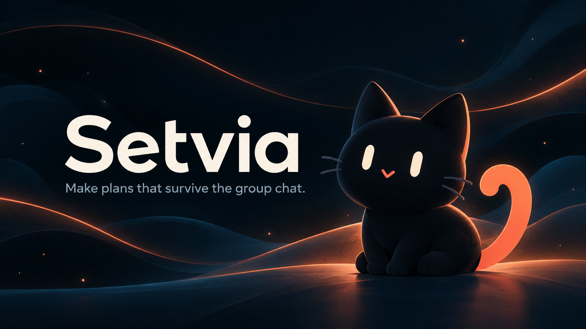

# Setvia

Make plans that survive the group chat.

**Live site:** [https://setvia.r4yv.tech](https://setvia.r4yv.tech)



Setvia is a Phase 1 UI prototype. All planning content is mocked. There is no backend, live room collaboration, production model inference, or real export generation.

## Local development

Requires Node.js 22.12+ or 24 LTS.

```sh
npm install
npm run dev
```

Open http://127.0.0.1:5173. Run `npm run build` for the TypeScript and production build check.

## Routes

- `/`: landing page
- `/start`: room idea form preview
- `/join`: nickname and room link form preview
- `/demos`: fictional scenario entry point

This prototype sends no data to model APIs. Future production inference is planned to use Meta models. Lexend is provided by @fontsource-variable/lexend (OFL-1.1); icons use lucide-react (ISC). Respect reduced-motion preferences.
