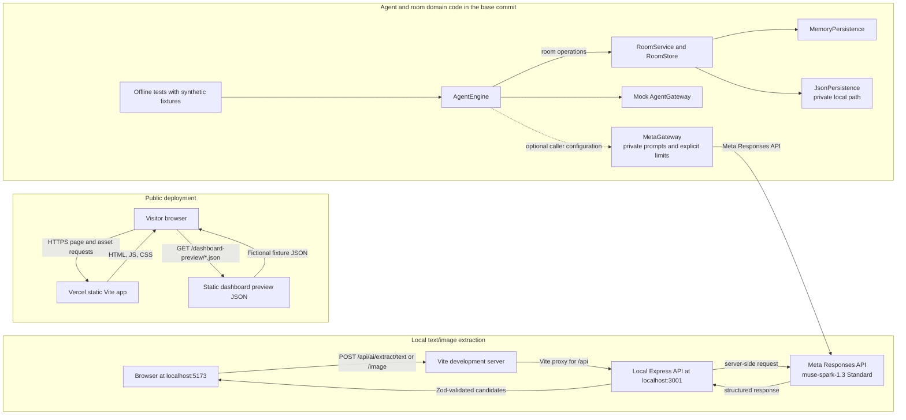
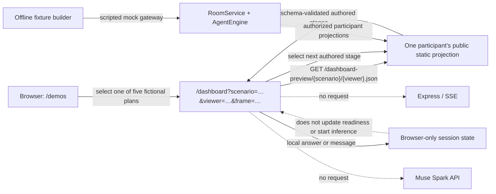
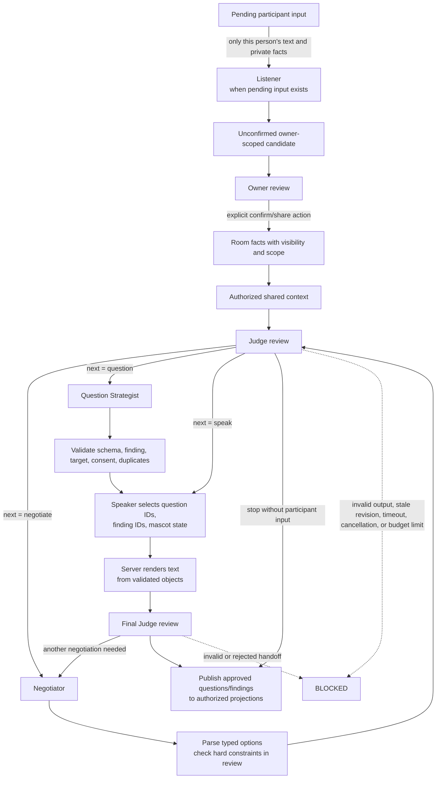
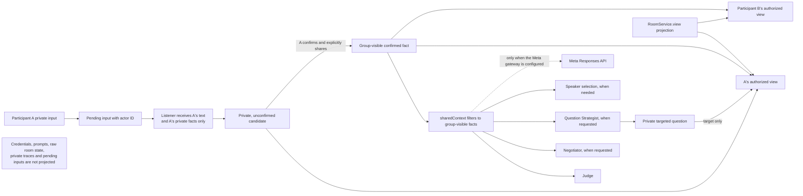
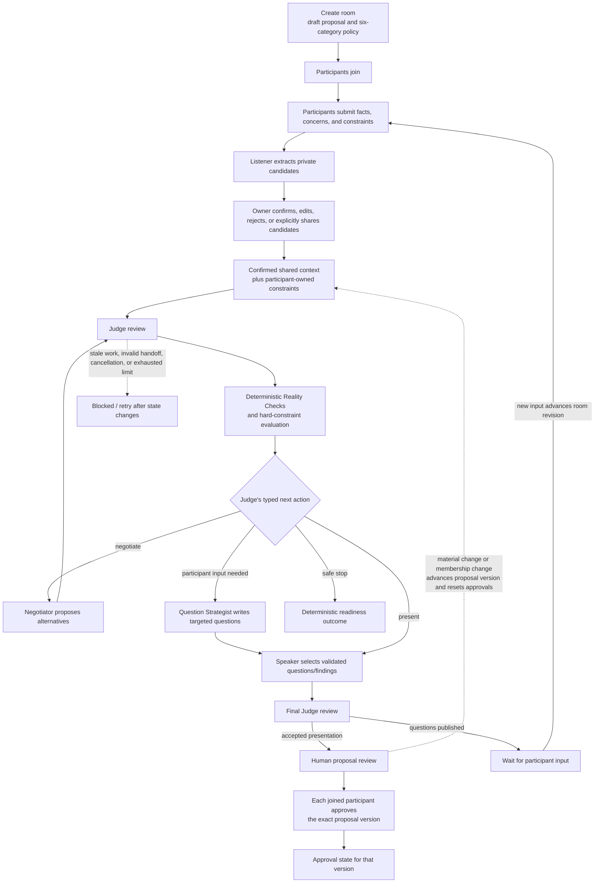

# Setvia architecture

This page describes the current `main` source. Its Mermaid blocks are the editable, source-controlled technical diagrams. The public site is a static Vite frontend backed by a separate Express API for model-powered actions.

## System boundaries

- **Public site:** static React/Vite pages and JSON preview fixtures on Vercel. `/demos` and `/dashboard` use fictional data; the homepage’s four-card role playground sends bounded requests to the separate API only after a user action.
- **Meta API:** the Express server uses a server-side `MODEL_API_KEY`. The homepage playground calls Muse Spark 1.3 through this server; the key is never sent to the browser. Vite proxies `/api` to a local Express server during development.
- **Agent runtime:** the repository includes the `AgentEngine`, `RoomService`, persistence adapters, role gateway, and authenticated room routes. The homepage playground demonstrates bounded role calls, not a complete collaborative room cycle.
- **Persistence:** the code includes in-memory and private-path JSON adapters. It has no database. The JSON adapter is single-process local storage, not a validated production durability design.
- **Unpublished Stage B:** a separate local integration branch contains work that is not included in the base commit or public deployment. Its latest recorded real checks do not establish a complete live planning-room cycle.

## A. Overall system architecture

**Accessible description:** The public browser downloads the static Vite application and synthetic dashboard JSON from Vercel. In local development, a browser sends extraction requests through Vite to Express, which calls Meta server-side. A separate test/domain path exercises the agent engine with a mock gateway and either memory or private JSON persistence; an optional Meta gateway requires caller-supplied prompts and explicit limits.

The Vercel deployment serves the Vite frontend; it does not host the Express API. The separate API exposes health, text/image extraction, the bounded playground when enabled, and authenticated room routes when the live runtime is configured. Its API key and role prompts remain server-side.

### Local judge-demo fixture path

The current polish worktree uses a separate offline demo path. `npm run demo:fixtures` runs fictional rooms through the domain code with a scripted mock gateway, then writes one schema-validated JSON file per scenario and selected participant. The browser loads a chosen authored stage. Participant messages and approval clicks stay in local browser state and do not call the room API, SSE, or Meta. This path is not deployed by these local changes.

The per-viewer split protects the demo UI projection boundary; these assets are still publicly fetchable static files and therefore contain fictional material only. See the [judge demo guide](judge-guide.md#offline-judge-demo-in-this-worktree) for the states and limitations.

## B. Conditional multi-agent orchestration

**Accessible description:** Pending input is interpreted by Listener in an owner-only context and becomes an unconfirmed private candidate. The owner can explicitly confirm and share a fact. Judge then chooses whether to negotiate, ask a question, present findings, or stop. Negotiator and Question Strategist run only when requested. Speaker selects validated references; the server renders their text and a final Judge reviews it. Bounded failures block the cycle.

The scheduler follows the typed Judge decision. It does not always run five roles in order: Listener runs only for pending input; Negotiator runs only when another option is useful; Question Strategist runs only when participant input is needed; Speaker runs when the Judge asks to speak or when validated questions need presentation. A final Judge reviews the Speaker selection before the application publishes it. A no-question stop can complete; a question outcome waits for participants and does not poll on its own.

### Contracts and server-enforced checks

- [`contracts.ts`](https://github.com/rayvin04/setvia/blob/main/server/src/agents/contracts.ts) defines strict Zod contracts for facts, constraints, findings, options, questions, readiness, traces, cycles, and rooms. The Meta gateway converts role contracts to JSON Schema for structured output.
- [`engine.ts`](https://github.com/rayvin04/setvia/blob/main/server/src/agents/engine.ts) parses each role handoff, checks evidence IDs against known group facts and constraints, validates option verdicts against hard constraints, checks question targets/consent/repetition, and renders messages from validated questions and findings.
- [`readiness.ts`](https://github.com/rayvin04/setvia/blob/main/server/src/agents/readiness.ts) calculates readiness deterministically. The Judge may report an assessment, but its percentage is not accepted as the readiness score.
- Role invocation, revision, elapsed-time, request, token, and cost limits are supplied by application configuration. The engine reserves a request allowance before the gateway sends an HTTP attempt. The agent Meta gateway disables automatic retries. Stale room revisions, cancellation, schema failures, unsupported evidence, request-budget exhaustion, and interrupted work fail closed.
- A model recommendation is not an enforcement action. The server owns validation, readiness, privacy projection, and human approvals.

The five-role integration has a material live limitation. A historical synthetic live-call evaluation is recorded in [agent-foundation.md](agent-foundation.md). A newer, separate Stage B worktree has three targeted live contract checks recorded as passing, but its full real planning-room cycle remains unverified. That worktree is unpublished and not part of this commit.

## C. Privacy boundaries

**Accessible description:** Private participant input goes only to that participant's Listener context and remains an owner-scoped candidate. The owner must explicitly share it before it enters shared context. Group roles receive only authorized shared facts. Each participant receives a server-built projection that excludes other people's private fields. If the Meta gateway is configured, it sends the role's authorized context to Meta from the server.

[`sharedContext`] filters facts to group visibility. The Listener receives a narrow private input rather than the group context. Room projections include shared material and only the current viewer's private facts/candidates and authorized questions/messages. Public targeting of a participant requires that participant's consent. The code also redacts private Listener trace inputs and outputs.

For local text/image extraction, the submitted source is sent to Meta for processing; the app does not persist the image or request body. Standard model selection is not a zero-retention promise. The public Vercel demo uses static synthetic data, so it does not exercise these private-room code paths.

## D. Planning lifecycle

**Accessible description:** A room starts with a draft proposal and policy, then people join and provide facts and constraints. Reality Checks run over confirmed shared information. The agents can request another option or participant answers. The server presents validated findings and questions; people review and approve an exact proposal version. Any change that advances the version clears approvals.

In the released base, room revision is a concurrency/freshness counter. Proposal version is the approval identity. Every accepted room update advances the room revision; plan, policy, shared-fact, constraint, and membership changes also advance the proposal version and invalidate prior votes. New participants and estimated event attendees are distinct: only joined room participants are the approvers.

The lifecycle is domain code, not a claim of a production collaboration service. The public dashboard uses static JSON fixtures and local preview interactions. Shareable decision summaries, event cards, illustrated plans, preparation exports, and downloadable records are future capabilities, not implemented exports.
